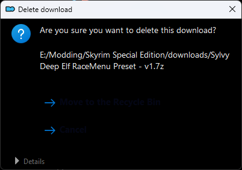
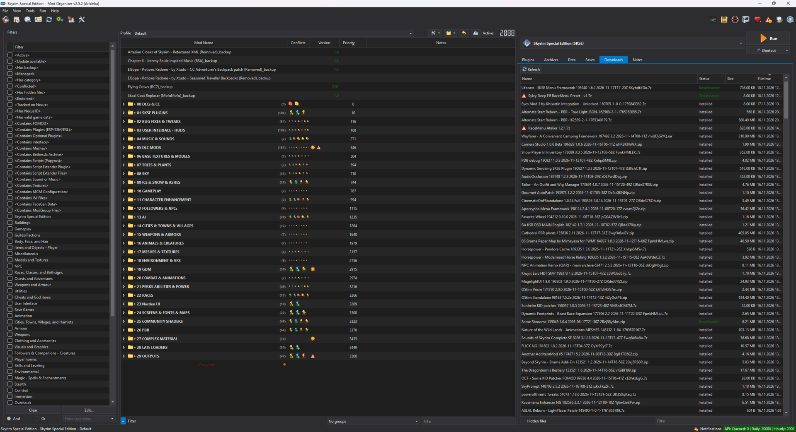
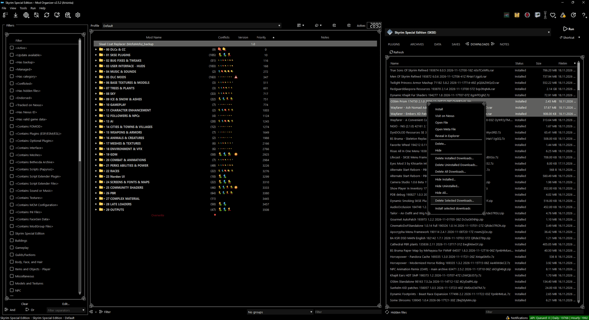

# Mod Organizer 2 Plugins

A collection of small plugins for Mod Organizer 2.

## Windows Vista Theme Fix

Windows Vista Theme Fix is a plugin that improves command-link button text in dark themes using the **windowsvista** Qt base style (which is set as the default unless you change it).

It addresses dark blue text and the gradual color transition seen on buttons in dialogs such as **Delete Download**. The plugin uses the theme’s existing palette, no special QSS rules are required.

**Installation:** Copy `WindowsVistaThemeFix.py` into MO2's `plugins` folder and restart MO2.

**Compatibility:** Intended for dark themes using the `windowsvista` base style. Detection depends on the theme’s Qt palette, so results may vary between themes.

## Windows 11 Title Bar

Give MO2's title bars a better match for your theme. This plugin uses each window's Qt palette to set the title bar and text colors, and updates them when the window's style or palette changes.

It works with both dark and light themes, without any special QSS rules. The result depends on the colors provided by the theme's palette, so it may not match every theme perfectly. If a palette color is invalid or fully transparent, Windows uses its default color for that part of the title bar.

**Requirements:** Windows 11 (build 22000 or newer).

**Installation:** Copy `Windows11TitleBar.py` into MO2's `plugins` folder and restart MO2.

## Bulk Delete Downloads

Select multiple downloads in MO2's Downloads tab, right-click and choose **Delete Selected Downloads...** to move their archives and adjacent `.meta` files to the Windows Recycle Bin after confirmation. The confirmation shows up to ten file paths.

The plugin accepts completed ZIP, RAR and 7Z archives inside the configured Downloads folder. If any selection fails validation, nothing is moved. Once deletion starts, individual failures are reported, some files may already have been moved. Windows may warn before permanently deleting a file if it cannot be recycled.

**Installation:** Copy `BulkDeleteDownloads.py` into MO2's `plugins` folder and restart MO2.

